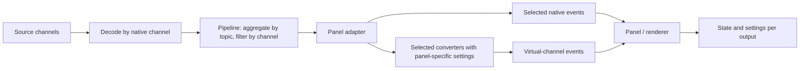

# Message pipeline: changes from `main`

This document compares local `main` with the working tree on
`fix/multi-schema-topics`, as inspected on 2026-11-06. It includes tracked edits
and new channel-related files, not just committed changes.

The two commits ahead of `main` (`11cd136de` and `62e068a3a`) introduce
independent converter outputs, output settings, and settings identity preservation.
The uncommitted work extends that model into native and virtual channel discovery,
selection, playback, historical reads, and inspection UI.

Interface excerpts below omit unchanged members. They describe the implementation
at inspection time, rather than a proposed API. No tests were run for this document.

## Architectural summary

On `main`, a topic name often serves three purposes: transport selection, stream
identity, and the key for rendering state and saved settings. That assumes one
native schema and one independently configurable output per topic.

The new implementation separates these responsibilities:

| Concept | Responsibility |
| --- | --- |
| Topic | Source name and grouping for streams; still used to aggregate transport subscriptions. |
| Native channel | One source stream, with its own identity and decoding information. |
| Virtual channel | One converter registration applied to one native input channel. |
| Schema | Describes message structure and selects compatible converters/render handlers. It does not uniquely identify a producer. |
| Output descriptor/key | Identifies an original or converted output for rendering and configuration. |

For example, `/data` can contain native channels A and B, plus converter X and
converter Y applied to A. Even when X and Y produce the same schema, they have
different virtual channel IDs and can have separate visibility and settings.
All four streams retain `/data` as their message topic.



Conversions remain local to each consuming panel adapter. Virtual channel
discovery does not create a global conversion stage or share conversion results
between panels.

## Public extension interfaces

Source: [packages/suite/src/index.ts](packages/suite/src/index.ts).

### New `Channel` type and `RenderState.channels`

There is no equivalent channel catalog on `main`. Previously, panels discovered
topics and optional destination schema names through `RenderState.topics`.

```ts
// Added
export type Channel = {
  id: string;
  topic: string;
  schemaName: string;
  source:
    | { kind: "native" }
    | { kind: "converted"; inputChannelId: string; converterId: string };
};

export type RenderState = {
  // Existing
  topics?: Topic[];
  // Added
  channels?: Channel[];
};
```

IDs are opaque identities within the current data source. Consumers should use
the advertised ID rather than reconstructing one from labels.

### `Topic`: source identity and exact conversion discovery

```ts
// main
export type Topic = {
  name: string;
  schemaName: string;
  convertibleTo?: readonly string[];
};

// Current: all previous members remain; these are added
export type Topic = {
  channelId?: string;
  conversionOutputs?: readonly {
    converterId: string;
    schemaName: string;
    displayName?: string;
    defaultConfig?: unknown;
  }[];
  // ...unchanged members
};
```

`convertibleTo` remains available for legacy consumers. Unlike destination schema
names, `conversionOutputs` can distinguish two registrations with the same schema
pair. Multiple advertised topic entries can now share `name`.

### `Subscription`: exact channel and converter selection

```ts
// main: relevant selection members
export type Subscription = {
  topic: string;
  convertTo?: string;
  // ...preload, sampling, etc.
};

// Current: added members
export type Subscription = {
  channelId?: string;
  converterId?: string;
  // ...unchanged members
};
```

| Selection | Behavior |
| --- | --- |
| `{ topic }` | Retains topic-wide native delivery. |
| `{ topic, convertTo }` | Retains legacy schema-based converter selection. |
| `{ topic, convertTo, converterId }` | Requests an exact converter registration. An unavailable registration does not fall back. |
| `{ topic, channelId }` with a native ID | Selects exactly that native stream. |
| `{ topic, channelId }` with a virtual ID | Resolves to its native input plus its exact converter and destination schema. |
| Unknown explicit channel ID | Delivers no messages. |

An explicit native channel selection clears conversion selectors during channel
resolution. An explicit virtual selection supplies them from the channel catalog.

### `MessageEvent`: stream identity and output provenance

On `main`, an event already carries `topic`, `schemaName`, timestamps, payload,
optional `topicConfig`, and optional `originalMessageEvent`. Those members remain.

```ts
// Added types
export type TopicOutput =
  | {
      kind: "original";
      sourceSchemaName: string;
      sourceChannelId?: string;
    }
  | {
      kind: "converted";
      sourceSchemaName: string;
      converterId: string;
      sourceChannelId?: string;
    };

export type TopicOutputDescriptor = {
  topic: string;
  schemaName: string;
  output: TopicOutput;
};

// Added MessageEvent members
export type MessageEvent<T = unknown> = {
  channelId?: string;
  output?: TopicOutput;
  // ...unchanged members
};
```

A converted event carries the virtual channel ID, destination `schemaName`, and
converter output metadata. Its `topic` remains the source topic, and its input
remains accessible through `originalMessageEvent`. Missing `output` metadata
denotes original data. Channel identity can also be recovered from the original
event when deriving a renderer output key.

### `SubscribeMessageRangeArgs`: matching historical selection

```ts
// main: relevant members
export type SubscribeMessageRangeArgs = {
  topic: string;
  convertTo?: string;
  onNewRangeIterator: (
    batchIterator: AsyncIterable<Immutable<MessageEvent[]>>,
  ) => Promise<void>;
};

// Current: added members
export type SubscribeMessageRangeArgs = {
  channelId?: string;
  converterId?: string;
  // ...unchanged members
};
```

The panel adapter resolves virtual selection to a native range read and then
applies the selected conversion. Current-frame and range delivery use the same
channel catalog and original-message selection rules.

### Converter registration and settings contracts

```ts
// Added to RegisterMessageConverterArgs<Src>
id?: string;
displayName?: string;

// Added to SettingsTree
topicOutputs?: readonly TopicOutputDescriptor[];

// Added to SettingsTreeNode
labelBadge?: { text: string; tooltip?: string };
```

Previously, registration identity was effectively based on extension and schema
pair. Registration now derives a converter ID from the extension's qualified
name and explicit `id`, falling back to the schema pair when `id` is omitted.
Duplicate registration identities are rejected. Two registrations for the same
pair therefore need distinct explicit IDs.

The signatures of `PanelSettings.settings` and `PanelSettings.handler` do not
change. Their behavior gains an output-aware path: opted-in panels supply an
isolated output config, and handler action paths are translated to the existing
`["topics", topicName, ...]` convention.

## Internal player and pipeline interfaces

Sources: [players/types.ts](packages/suite-base/src/players/types.ts) and
[MessagePipeline/types.ts](packages/suite-base/src/components/MessagePipeline/types.ts).

### Native discovery and subscriptions

```ts
// Added to internal Topic; existing name/schema/decoding members remain
channelId?: string;

// Added to SubscribePayload; existing topic/preload/sampling members remain
channelIds?: string[];
```

The internal selector is plural because requests from several consumers are
merged for transport:

- Omitted `channelIds` means every native channel on the topic.
- An empty array means no channels.
- Two explicit selections merge by union.
- Any topic-wide request makes the merged selection topic-wide.

`TopicSelection` remains a map keyed by topic name. Its existing subscription
values now carry channel selections; the map itself is not replaced by a map
keyed by channel.

### Batch iteration and point-in-time reads

```ts
// main: Player and MessagePipelineContext
getBatchIterator: (
  topic: string,
  options?: { start?: Time; end?: Time },
) => AsyncIterableIterator<Readonly<IteratorResult>> | undefined;

// Current: Player and MessagePipelineContext
getBatchIterator: (
  topic: string,
  options?: { start?: Time; end?: Time; channelId?: string },
) => AsyncIterableIterator<Readonly<IteratorResult>> | undefined;

// main: MessagePipelineContext
getMessageAtTime: (topic: string, time: Time) => Promise<MessageEvent | undefined>;

// Current: MessagePipelineContext
getMessageAtTime: (
  topic: string,
  time: Time,
  channelId?: string,
) => Promise<MessageEvent | undefined>;
```

These internal channel arguments select native inputs. Virtual selections are
resolved in the panel adapter, where converter settings belong.

`Player.getBackfillMessages` retains its signature. Its existing topic selection
argument gains channel filtering through `SubscribePayload.channelIds`. MCAP
backfill now returns the latest message per selected channel, rather than stopping
after the first message for a topic.

### Adapter support interfaces

Source: [PanelExtensionAdapter/types.ts](packages/suite-base/src/components/PanelExtensionAdapter/types.ts).

```ts
// Added to DraggedMessagePath
channelId?: string;

// Added to CreateMessageRangeIteratorParams
channelId?: string;
converterId?: string;
config?: TopicOutputConfig;
panelType?: string;

// Added to BuiltinPanelExtensionContext (internal, not public extension API)
unstable_setTopicOutputConfigHandler?: (
  handler:
    | ((topic: string, key: string, config: Record<string, unknown>) => void)
    | undefined,
) => void;
```

`InstalledMessageConverter` also gains optional `converterId` and `extensionName`.
The ID is assigned during registration; optionality supports legacy in-process
fixtures.

## Rendering and saved settings

Sources: [IRenderer.ts](packages/suite-base/src/panels/ThreeDeeRender/IRenderer.ts)
and [topicOutput.ts](packages/suite-base/src/util/topicOutput.ts).

### Configuration storage

```ts
// main: RendererConfig
topics: Record<string, Partial<BaseSettings> | undefined>;

// Current: topics remains; this is added
topicOutputs?: Record<string, Record<string, Partial<BaseSettings>>>;
```

The new storage is `topicOutputs[topicName][outputKey]`. An output key encodes
topic, source schema, original/converted kind, converter ID for converted outputs,
and optional source channel identity. Source channel identity is included in
render descriptors when native channels share both topic and schema name.

The settings UI uses paths shaped as `["topics", topicName, outputKey, ...]`;
these paths are translated to the separate `topicOutputs` storage.

Effective settings merge panel defaults and converter defaults with the saved
output override. If no output override exists, legacy `topics[topicName]` settings
are used as fallback. Channel-specific lookup can also fall back to an existing
output override without the channel qualifier. Reads do not write a migration
into the layout.

### Added renderer boundary methods

These methods have no equivalent output-aware contract on `main`:

```ts
readonly renderTopics: readonly RenderTopic[];
getTopicSettings(): Readonly<Record<string, Partial<BaseSettings> | undefined>>;
getRenderTopic(event: Pick<MessageEvent, "topic" | "schemaName" | "output">): string;
getSourceTopic(key: string): string;
resolveTopicOutput(key: string | undefined, schemas: ReadonlySet<string>): string | undefined;
getTopicLabel(key: string): string;
getSettingsPath(path: readonly string[]): string[];
saveTopicSetting(path: readonly string[], value: unknown): void;
setTopicSettings(draft: RendererConfig, key: string, settings: Partial<BaseSettings>): void;
```

The concrete `Renderer.getRenderTopic` additionally accepts optional event channel
and original-event metadata in its `Pick`, which it uses to resolve exact outputs.
These helpers centralize output identity and effective settings for renderables.
Schema handlers remain schema-based; state and visibility distinguish producers.

## Behavior changes at each pipeline boundary

| Boundary | `main` | Current working tree |
| --- | --- | --- |
| MCAP discovery | Indexed discovery collapses channels by topic name. | Indexed and unindexed readers advertise individual native channels. Topic statistics aggregate counts. |
| WebSocket discovery | Rejects distinct advertised channels sharing a topic. | Retains and subscribes to matching channel IDs independently. |
| Multiple recordings | Topic-oriented merging. | Qualifies explicit IDs with `source:<index>:` and translates selectors back to source-local IDs. |
| Deserialization | Decoder lookup by topic. | Decoder lookup by channel, or logical topic/schema identity for legacy sources. |
| Sampling | Pending latest message keyed by topic. | Pending latest message keyed by channel; adapter sampling is conservatively disabled for multi-entry topics. |
| Subscription dispatch | Topic membership determines delivery. | Topic lookup narrows candidates, then channel matching determines delivery. |
| Last-message replay | One last message per topic; subscription changes compared by topic. | Separate explicit channel messages; switching channels on the same topic can replay the newly selected stream. |
| Seek/backfill | Topic is generally the unit of latest-message coverage. | Selected channels are backfilled independently; pipeline replay cache clears on seek or player changes. |
| Converter selection | Destination schema selects a matching registration. | Optional exact converter/channel selection; conversion uses the actual event schema. |
| 3D latest-message reduction | Groups messages by topic. | Groups by channel/output identity so native and converted producers do not displace each other. |
| 3D configuration | One visibility/settings block per topic. | Independent output settings and rendering keys, with legacy fallback. |
| Inspection UI | Primarily topic/message-path selection. | Channels inspector and Raw Messages can select native or converted streams; channel IDs are saved separately from message-path syntax. |

## Compatibility and remaining limits

- Existing optional-field-free subscriptions remain usable. Sources without
  explicit channel IDs get logical native identities derived from topic/schema.
- Topic names on events are unchanged. Renderer output keys are local identities,
  not transport topic renames.
- Channel IDs are source-local, not durable across reordered recordings or live
  reconnects that assign different numbers. Saved selections depending on those
  IDs have the same limitation.
- Per-channel decoding does not resolve the global datatype registry's schema-name
  collisions. Conflicting same-name schema definitions still need a channel-scoped
  metadata registry for accurate field discovery.
- Channel-aware backfill currently bypasses the caching source's backfill cache:
  topic-level cache completeness cannot establish per-channel coverage.
- Raw Messages exposes channel-aware selection, including independent comparison
  selections. Other panels still need channel-aware pickers.
- This is an incremental extension of the topic-based pipeline. Topic-keyed
  structures and legacy schema lookup paths still exist; the implementation does
  not replace every topic-based interface with a channel-based one.

## Relevant verification coverage

The working tree contains tests for exact native/virtual selection, unavailable
IDs, producer-specific converter settings, range delivery, same-name schema
decoding, per-channel sampling and backfill, combined-recording namespaces, and
seeking with synchronized channels. Useful entry points:

- [Adapter channel access](packages/suite-base/src/components/PanelExtensionAdapter/channelAccess.test.ts)
- [MCAP channel access](packages/suite-base/src/players/IterablePlayer/Mcap/channelAccess.test.ts)
- [Seek channels](packages/suite-base/src/players/IterablePlayer/seekChannels.test.ts)
- [Pipeline subscriptions](packages/suite-base/src/components/MessagePipeline/subscriptions.test.ts)
- [Pipeline store](packages/suite-base/src/components/MessagePipeline/store.test.ts)

These references describe test coverage present in source, not a test pass result.
